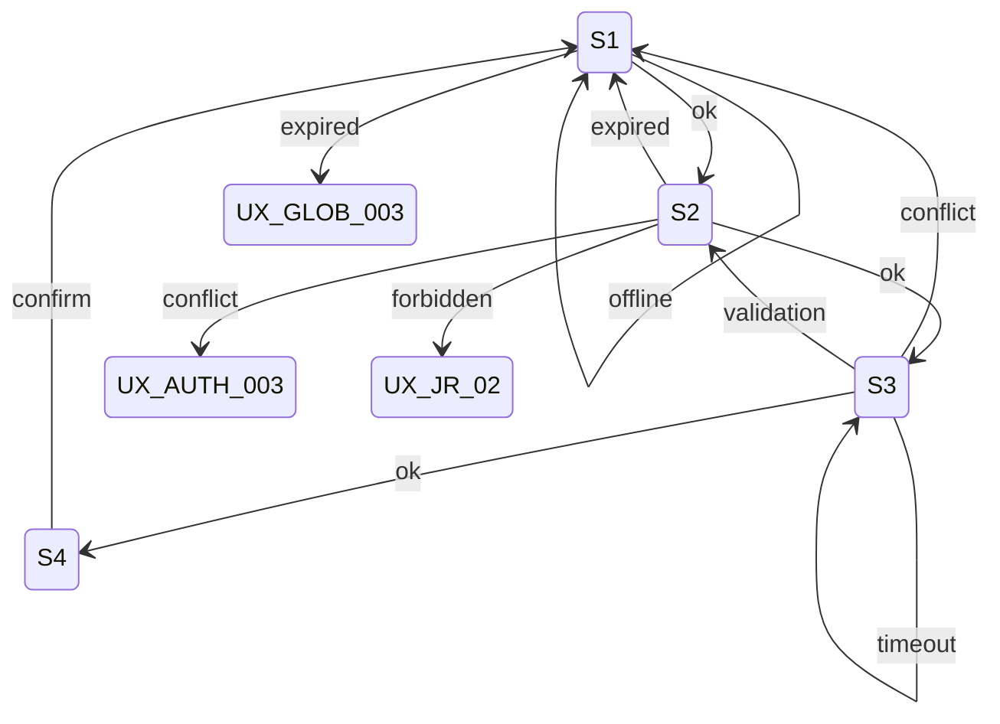
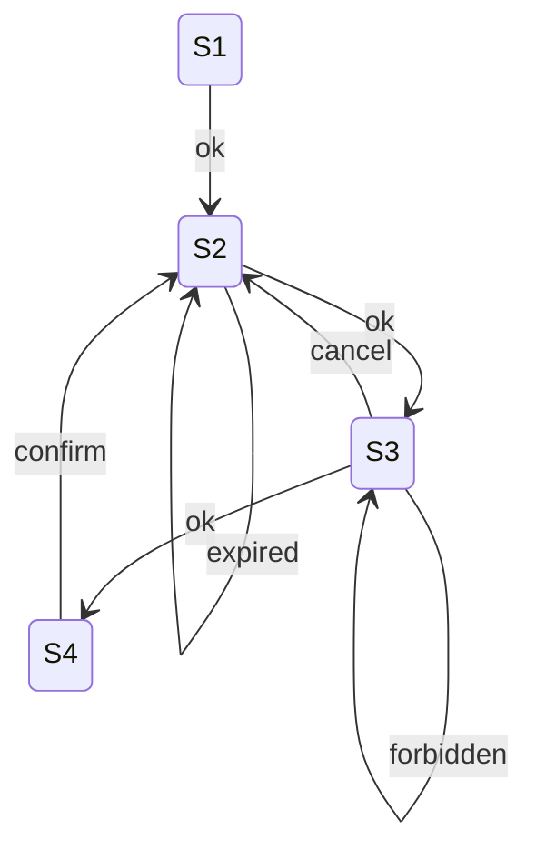
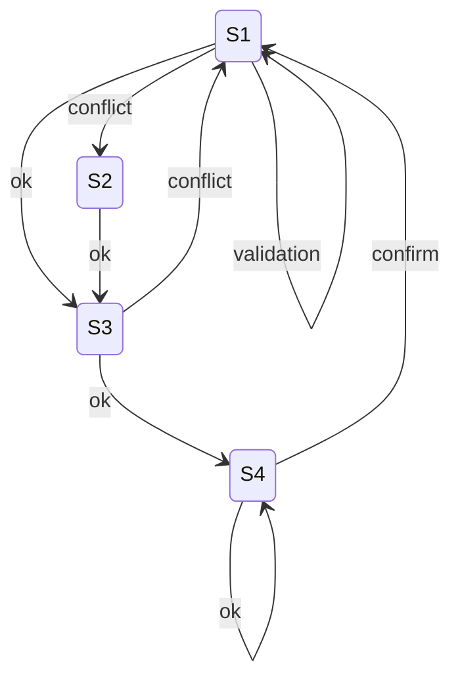
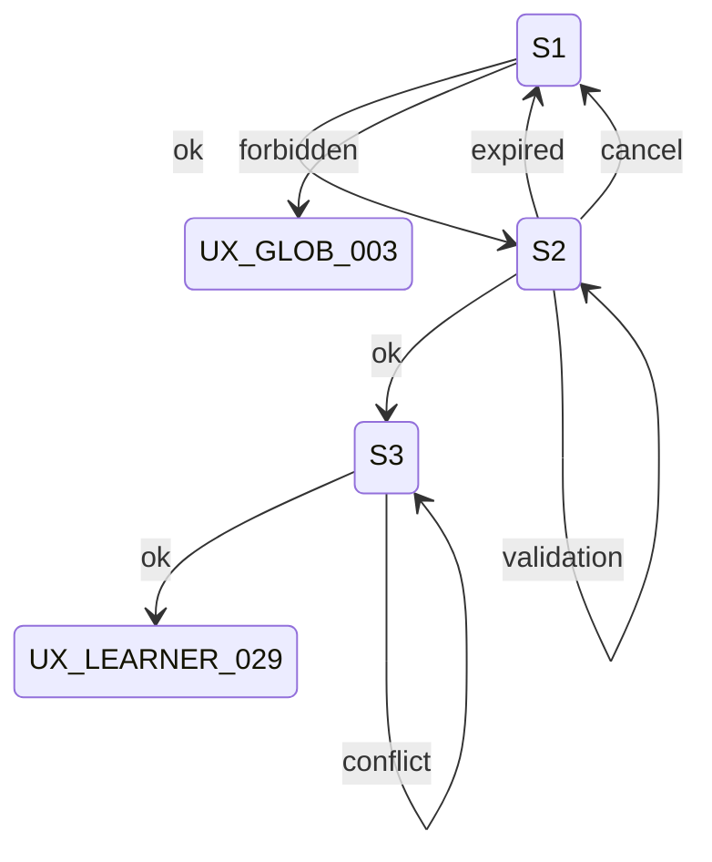
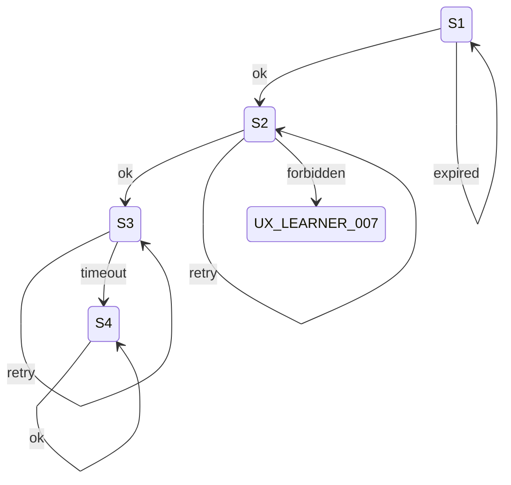
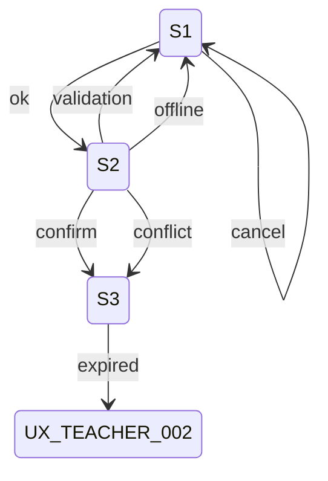
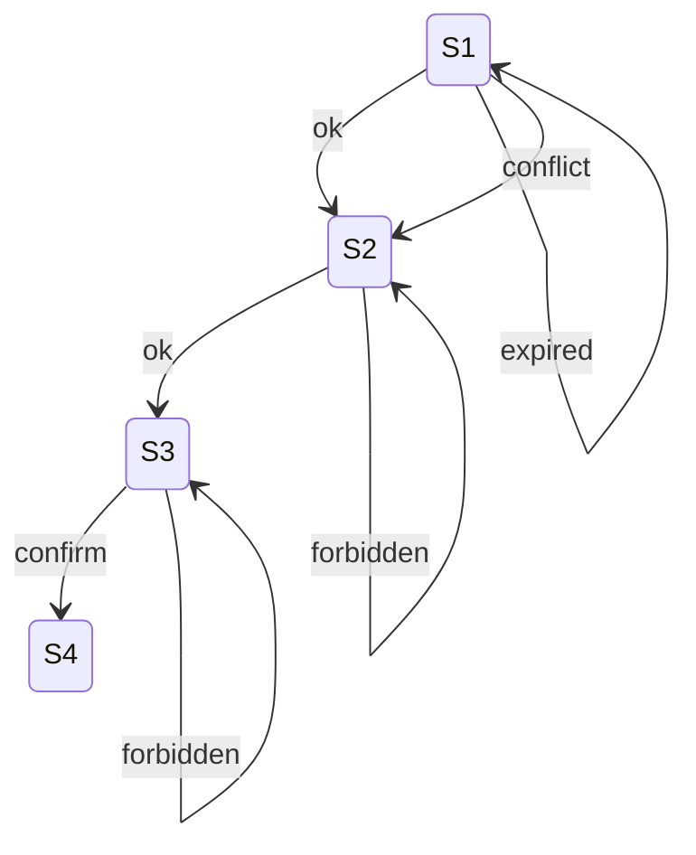
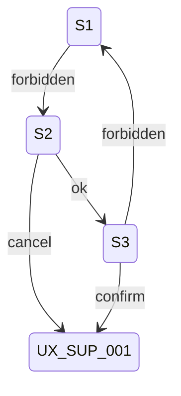
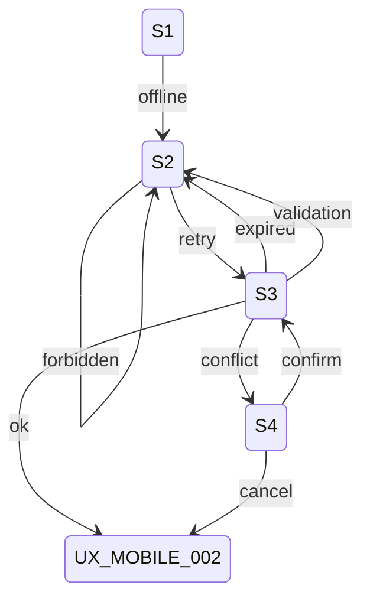

# Critical journeys — state models

Drawn on the canvas page “Critical journeys” (`UX-JR-01..09`). These are state models for implementation and testing, **not** backend behaviour. Each role step is a separate authenticated session.

## UX-JR-01 · Guest level-assessment booking
- Who: Guest → new adult learner
- FRs: FR-GEO-002, FR-TIME-007, FR-IAM-003
- ⚠️ Unresolved: O-02 whether the assessment is free and in which markets
- ⚠️ Unresolved: No slot-hold endpoint

### S1 — Pick a slot (Guest)
- Screens: `UX-PUBLIC-009` · API: `get__api_v1_booking_available_slots`
- Shows: Slots in the visitor’s zone with offset; assessment price from their market or “to be confirmed”.

| Event | Kind | Next | User sees (EN) | User sees (AR) |
|---|---|---|---|---|
| Picked a slot | ok | `S2` | We hold the slot while you create your account. | نحجز الموعد مؤقتًا أثناء إنشاء الحساب. |
| No slots in market | expired | `UX-GLOB-003` | No slots right now. Join the waitlist and we’ll notify you. | لا مواعيد متاحة الآن. انضم لقائمة الانتظار وسنبلغك. |
| Went offline | offline | `S1` | Booking needs a connection. Your choice is kept on this page. | الحجز يحتاج اتصالًا. اختيارك محفوظ في الصفحة. |

### S2 — Minimal account + hold (Guest)
- Screens: `UX-AUTH-001` · API: `post__auth_register + UNRESOLVED — slot hold`
- Shows: A visible hold countdown [duration — product decision] and only the necessary fields.

| Event | Kind | Next | User sees (EN) | User sees (AR) |
|---|---|---|---|---|
| Account created | ok | `S3` | — | — |
| Email already registered | conflict | `UX-AUTH-003` | You already have an account. Log in and we’ll continue the same booking. | لديك حساب بهذا البريد. سجّل الدخول وسنكمل الحجز نفسه. |
| Age band under 18 | forbidden | `UX-JR-02` | We need guardian consent before confirming. | نحتاج موافقة ولي الأمر قبل تأكيد الحجز. |
| Hold expired | expired | `S1` | Your hold expired. Pick again — the same time may still be free. | انتهت مدة حجز الموعد. اختر موعدًا من جديد — قد يكون الموعد نفسه متاحًا. |

### S3 — Confirm booking (Learner)
- Screens: `UX-PUBLIC-009`, `UX-GLOB-005` · API: `post_bookings (Idempotency-Key)`
- Shows: Confirm disables after the first tap with “Confirming…”.

| Event | Kind | Next | User sees (EN) | User sees (AR) |
|---|---|---|---|---|
| Booked | ok | `S4` | — | — |
| Slot taken (409) | conflict | `S1` | Someone just took this time. Here are the 3 nearest alternatives. | سبقك أحد لهذا الموعد. هذه أقرب 3 مواعيد بديلة. |
| Network timeout | timeout | `S3` | Checking your booking… don’t tap again. We retry with the same operation key. | نتحقق من حالة حجزك… لا تعِد الضغط. نعيد الإرسال بنفس مفتاح العملية. |
| Validation (422) | validation | `S2` | Some details need fixing. We highlighted the fields. | بعض البيانات تحتاج تصحيحًا. حددنا الحقول المطلوبة. |

### S4 — Booked (Learner)
- Screens: `UX-LEARNER-001` · API: `get_bookings`
- Shows: Time in learner’s and teacher’s zones, calendar file, what to prepare.

| Event | Kind | Next | User sees (EN) | User sees (AR) |
|---|---|---|---|---|
| Cancelled before start | confirm | `S1` | Cancelling frees the slot and can’t be undone. Refund policy: [decision O-02]. | إلغاء الحجز يحرر الموعد ولا يمكن التراجع. سياسة الاسترداد: [قرار O-02]. |

## UX-JR-02 · Minor sign-up and guardian verification
- Who: Minor learner + guardian (two separate sessions)
- FRs: FR-IAM-006, FR-IAM-009
- ⚠️ Unresolved: O-04 legal guardian-verification method
- ⚠️ Unresolved: No guardian-invite or consents-list endpoint

### S1 — Age band captured (Minor)
- Screens: `UX-AUTH-001` · API: `post__auth_register`
- Shows: We ask for an age band only, not a full birth date.

| Event | Kind | Next | User sees (EN) | User sees (AR) |
|---|---|---|---|---|
| Under 18 | ok | `S2` | We’ll ask a guardian for consent. Until then the account runs in limited mode. | سنطلب موافقة ولي الأمر. حتى ذلك الحين يعمل الحساب بوضع محدود. |

### S2 — Invite guardian (Minor)
- Screens: `UX-AUTH-002` · API: `UNRESOLVED — guardian invite`
- Shows: Limited mode: no live lessons, no audio recording, no competition visibility.

| Event | Kind | Next | User sees (EN) | User sees (AR) |
|---|---|---|---|---|
| Invite sent | ok | `S3` | — | — |
| Invalid guardian contact | validation | `S2` | Check the guardian’s phone or email. | تحقق من رقم أو بريد ولي الأمر. |
| Invite expired | expired | `S2` | The invite expired [duration — O-04]. Send a new one. | انتهت الدعوة [المدة — O-04]. أرسل دعوة جديدة. |

### S3 — Guardian verifies and consents (Guardian (separate session))
- Screens: `UX-AUTH-002`, `UX-ADMIN-004` · API: `post__consents`
- Shows: Separate consent per purpose: lessons, audio recording, competitions, AI.

| Event | Kind | Next | User sees (EN) | User sees (AR) |
|---|---|---|---|---|
| Consented to lessons | ok | `S4` | — | — |
| Declined | cancel | `S2` | The account stays limited. We keep only minimal data. | يبقى الحساب محدودًا. لا نحتفظ إلا بالحد الأدنى من البيانات. |
| Verification failed | forbidden | `S3` | We couldn’t verify the guardian. Try another method or contact support. | تعذّر التحقق من ولي الأمر. حاول طريقة أخرى أو تواصل مع الدعم. |

### S4 — Access per consents (Minor)
- Screens: `UX-LEARNER-001`, `UX-LEARNER-032` · API: `post__consents__consentId__withdraw`
- Shows: Each feature opens only under its own consent.

| Event | Kind | Next | User sees (EN) | User sees (AR) |
|---|---|---|---|---|
| Guardian withdrew a consent | confirm | `S2` | Features relying on it stop immediately; linked future lessons are cancelled after confirmation. | يتوقف ما يعتمد على هذه الموافقة فورًا، وتُلغى الحصص المستقبلية المرتبطة بعد التأكيد. |

## UX-JR-03 · Lesson booking across DST
- Who: Learner
- FRs: FR-TIME-007, FR-TIME-012

### S1 — Show slots (Learner)
- Screens: `UX-LEARNER-008` · API: `get__api_v1_booking_available_slots`
- Shows: Every slot shows the learner’s time with offset and IANA zone.

| Event | Kind | Next | User sees (EN) | User sees (AR) |
|---|---|---|---|---|
| Picked a normal slot | ok | `S3` | — | — |
| Nonexistent time (spring-forward) | validation | `S1` | This time doesn’t exist in your zone on the clock-change day, so we don’t offer it. | هذا الوقت غير موجود في منطقتك يوم تغيير التوقيت، لذا لا نعرضه. |
| Ambiguous time (fall-back) | conflict | `S2` | This time occurs twice. Choose the first (UTC+03:00) or second (UTC+02:00). | هذا الوقت يتكرر مرتين. اختر: الأول (UTC+03:00) أم الثاني (UTC+02:00). |

### S2 — Choose occurrence (Learner)
- Screens: `UX-GLOB-005` · API: `post_bookings`
- Shows: We show both with their offsets and never choose for you.

| Event | Kind | Next | User sees (EN) | User sees (AR) |
|---|---|---|---|---|
| Chose | ok | `S3` | — | — |

### S3 — Confirm in both zones (Learner)
- Screens: `UX-LEARNER-009` · API: `post_bookings (Idempotency-Key)`
- Shows: Stored in UTC; shown in your and the teacher’s zones.

| Event | Kind | Next | User sees (EN) | User sees (AR) |
|---|---|---|---|---|
| Booked | ok | `S4` | — | — |
| Teacher no longer free (409) | conflict | `S1` | That time is gone. Here are the nearest alternatives. | لم يعد الموعد متاحًا. اخترنا لك أقرب البدائل. |

### S4 — After booking (Learner)
- Screens: `UX-LEARNER-007`, `UX-GLOB-004` · API: `post__bookings__bookingId__reschedule`
- Shows: Changing your timezone changes the display only, never the lesson instant.

| Event | Kind | Next | User sees (EN) | User sees (AR) |
|---|---|---|---|---|
| Changed timezone | ok | `S4` | Upcoming lessons now show in your new zone. The actual time hasn’t changed. | حصصك القادمة تُعرض الآن بتوقيتك الجديد. الموعد الفعلي لم يتغير. |
| Requested reschedule | confirm | `S1` | Rescheduling frees the current slot. Notice policy: [product decision]. | تغيير الموعد يحرر الموعد الحالي. سياسة المهلة: [قرار المنتج]. |

## UX-JR-04 · Locked quote and payment with expiry
- Who: Learner or guardian
- FRs: FR-CURR-001, FR-PAY-001
- ⚠️ Unresolved: O-02 pricing per market
- ⚠️ Unresolved: Quote validity period

### S1 — Create quote (Learner)
- Screens: `UX-GLOB-006` · API: `post__api_v1_me_checkout_quotes`
- Shows: Locked quote: amount in minor units, tax, fees and “valid until” in your time.

| Event | Kind | Next | User sees (EN) | User sees (AR) |
|---|---|---|---|---|
| Reviewed and agreed | ok | `S2` | — | — |
| No price in market | forbidden | `UX-GLOB-003` | Subscriptions aren’t available in your country yet. | الاشتراك غير متاح في بلدك بعد. |

### S2 — Pay (Learner)
- Screens: `UX-GLOB-006` · API: `post__api_v1_me_payment_checkouts (Idempotency-Key)`
- Shows: We hand you to the payment provider. We never store card data.

| Event | Kind | Next | User sees (EN) | User sees (AR) |
|---|---|---|---|---|
| Returned paid | ok | `S3` | — | — |
| Quote expired | expired | `S1` | Your quote expired. We made a new one — review any difference before paying. | انتهت صلاحية عرض السعر. أنشأنا عرضًا جديدًا — راجع أي اختلاف قبل الدفع. |
| Cancelled at provider | cancel | `S1` | Nothing was charged. Your quote is valid until [expiry]. | لم يُخصم شيء. عرضك صالح حتى [وقت الانتهاء]. |
| Card declined | validation | `S2` | The bank declined. Try another method. | رفض البنك العملية. جرّب وسيلة أخرى. |

### S3 — Payment confirmation (Learner)
- Screens: `UX-LEARNER-029` · API: `get__payments__paymentId + post__webhooks_payments__provider`
- Shows: Status comes from the server (webhook), never from the return page.

| Event | Kind | Next | User sees (EN) | User sees (AR) |
|---|---|---|---|---|
| Confirmed | ok | `UX-LEARNER-029` | You’re subscribed. The invoice is in your account. | تم الاشتراك. الفاتورة في حسابك. |
| Pending | timeout | `S3` | Your payment is being confirmed. Don’t pay again — this page updates itself. | دفعتك قيد التأكيد. لا تدفع مرة أخرى — سنحدّث الصفحة تلقائيًا. |
| Duplicate payment attempt | conflict | `S3` | You already have a payment being confirmed for this quote. | لديك دفعة قيد التأكيد لهذا العرض. |

## UX-JR-05 · Live lesson: device permissions and provider failure
- Who: Learner + teacher
- FRs: FR-VIDEO-001, FR-ATT-003
- ⚠️ Unresolved: Mid-lesson provider switch details

### S1 — Device check (Learner)
- Screens: `UX-VPC-009`, `UX-MOBILE-003` · API: `get__lessons__lessonId`
- Shows: Camera and mic preview before joining. Recording is off unless a valid consent exists.

| Event | Kind | Next | User sees (EN) | User sees (AR) |
|---|---|---|---|---|
| Permissions granted | ok | `S2` | — | — |
| Mic permission denied | forbidden | `S1` | Your browser blocked the mic. Here’s how to allow it. Recitation needs a mic. | المتصفح منع الميكروفون. هذه خطوات السماح به في جهازك. التلاوة تحتاج ميكروفونًا. |
| Too early | expired | `S1` | Joining opens 10 minutes before. | يفتح الدخول قبل الحصة بـ10 دقائق. |

### S2 — Join (Learner)
- Screens: `UX-VPC-009` · API: `post__lessons__lessonId__join`
- Shows: We request a join token from the server per the provider routing policy.

| Event | Kind | Next | User sees (EN) | User sees (AR) |
|---|---|---|---|---|
| Joined | ok | `S3` | — | — |
| Provider down (5xx) | retry | `S2` | Trying the backup provider per academy policy… or open the approved external link. | نحاول مزودًا بديلًا وفق سياسة الأكاديمية… أو افتح الرابط الخارجي المعتمد. |
| Not a participant (403) | forbidden | `UX-LEARNER-007` | This lesson isn’t on your account. | هذه الحصة ليست في حسابك. |

### S3 — In lesson (Learner + teacher)
- Screens: `UX-VPC-009`, `UX-TEACHER-006` · API: `post__webhooks_video__provider`
- Shows: Connection-quality indicator and automatic reconnection.

| Event | Kind | Next | User sees (EN) | User sees (AR) |
|---|---|---|---|---|
| Dropped and returned | retry | `S3` | You’re back. The drop isn’t counted as absence. | عاد الاتصال. لم يُحتسب الانقطاع غيابًا. |
| Long outage | timeout | `S4` | The lesson was interrupted. A make-up is reviewed automatically. | انقطعت الحصة. نراجع التعويض تلقائيًا. |

### S4 — End and attendance (Learner)
- Screens: `UX-LEARNER-011` · API: `postAttendanceDispute`
- Shows: Attendance comes from provider and server logs.

| Event | Kind | Next | User sees (EN) | User sees (AR) |
|---|---|---|---|---|
| Disputes attendance | ok | `S4` | We received your dispute for review. | استلمنا اعتراضك وسيُراجع. |

## UX-JR-06 · Teacher report: draft, save, submit
- Who: Teacher
- FRs: FR-ATT-003, FR-TCHR-003
- ⚠️ Unresolved: No server-side draft endpoint

### S1 — Write report (Teacher)
- Screens: `UX-TEACHER-006`, `UX-TEACHER-007` · API: `UNRESOLVED — report draft`
- Shows: Autosave on device every few seconds with “Saved locally 5:12 PM”.

| Event | Kind | Next | User sees (EN) | User sees (AR) |
|---|---|---|---|---|
| Completed fields | ok | `S2` | — | — |
| Closed the browser | cancel | `S1` | We restored your draft saved on this device. | استعدنا مسودتك المحفوظة على هذا الجهاز. |

### S2 — Submit (Teacher)
- Screens: `UX-TEACHER-007` · API: `post__lessons__lessonId__report (Idempotency-Key)`
- Shows: Submission is final and visible to the learner.

| Event | Kind | Next | User sees (EN) | User sees (AR) |
|---|---|---|---|---|
| Submitted | confirm | `S3` | After submitting you can only request a correction. Submit? | بعد الإرسال لا يمكن التعديل إلا بطلب تصحيح. أرسل؟ |
| Missing field (422) | validation | `S1` | Complete “Recitation notes” before submitting. | أكمل «ملاحظات التلاوة» قبل الإرسال. |
| Already submitted elsewhere (409) | conflict | `S3` | A report for this lesson was submitted from another device. We show both versions. | أُرسل تقرير لهذه الحصة من جهاز آخر. نعرض النسختين. |
| Offline | offline | `S1` | Not submitted — it will send when you reconnect. | غير مُرسل — سيُرسل عند عودة الاتصال. |

### S3 — Submitted (Teacher)
- Screens: `UX-TEACHER-002` · API: `getLessonReport`
- Shows: “Submitted 5:20 PM” with a read link.

| Event | Kind | Next | User sees (EN) | User sees (AR) |
|---|---|---|---|---|
| Past deadline | expired | `UX-TEACHER-002` | The report is over 24 h late and visible to your supervisor. | التقرير متأخر عن 24 ساعة ويظهر لمشرفك. |

## UX-JR-07 · Competition appeal across separate role sessions
- Who: Learner → judge → admin → learner (each step its own session)
- FRs: FR-CONTEST-011
- ⚠️ Unresolved: No judge appeal-review endpoint
- ⚠️ Unresolved: Prize policy O-07

### S1 — Provisional result (Learner session)
- Screens: `UX-LEARNER-025` · API: `post__competition_results__resultId__appeal`
- Shows: Result is private by default, with a score explanation and appeal deadline.

| Event | Kind | Next | User sees (EN) | User sees (AR) |
|---|---|---|---|---|
| Filed appeal | ok | `S2` | Appeal received. Status: under review. | استلمنا تظلمك. الحالة: قيد المراجعة. |
| After deadline | expired | `S1` | The appeal window closed on [date]. The result is final. | انتهت مهلة التظلم في [التاريخ]. النتيجة نهائية. |
| Duplicate appeal (409) | conflict | `S2` | You already have an open appeal for this result. | لديك تظلم قائم لهذه النتيجة. |

### S2 — Judge review (Teacher/judge session)
- Screens: `UX-TEACHER-015` · API: `UNRESOLVED — judge appeal review`
- Shows: Recording and rubric only; a minor’s identity is hidden.

| Event | Kind | Next | User sees (EN) | User sees (AR) |
|---|---|---|---|---|
| Recommended | ok | `S3` | — | — |
| Conflict of interest | forbidden | `S2` | The appeal was reassigned to another judge. | أُعيد إسناد التظلم لمحكّم آخر. |

### S3 — Admin decision (Admin session)
- Screens: `UX-ADMIN-031` · API: `postAdminContestAppealResolve`
- Shows: Decision with a reason; the recommender can’t approve their own recommendation.

| Event | Kind | Next | User sees (EN) | User sees (AR) |
|---|---|---|---|---|
| Upheld / rejected | confirm | `S4` | The decision is final and sent to the learner. Confirm? | القرار نهائي ويُبلغ للمتعلم. اعتمد؟ |
| Self-approval | forbidden | `S3` | You can’t approve a decision you recommended. | لا يمكنك اعتماد قرار أوصيت به. |

### S4 — Final result (Learner session)
- Screens: `UX-LEARNER-025` · API: `getAdminContestAppeals (admin) · UNRESOLVED learner appeal status`
- Shows: Notification with the decision and reason.

| Event | Kind | Next | User sees (EN) | User sees (AR) |
|---|---|---|---|---|

## UX-JR-08 · Supervisor scope denial
- Who: Supervisor + platform admin
- FRs: FR-SUP-002, FR-SUP-008

### S1 — Open out-of-scope record (Supervisor session)
- Screens: `UX-SUP-001`, `UX-SUP-004` · API: `get__api_v1_supervisor_safeguarding_cases`
- Shows: Server returns 403 without revealing the record exists.

| Event | Kind | Next | User sees (EN) | User sees (AR) |
|---|---|---|---|---|
| 403 | forbidden | `S2` | This record isn’t available in your scope. | هذا السجل غير متاح ضمن نطاقك. |

### S2 — Request assignment (Admin session)
- Screens: `UX-SUP-008` · API: `post__api_v1_admin_supervisor_assignments`
- Shows: Assignment has a scope and expiry, and is audited.

| Event | Kind | Next | User sees (EN) | User sees (AR) |
|---|---|---|---|---|
| Assigned | ok | `S3` | — | — |
| Request declined | cancel | `UX-SUP-001` | Your access request was not approved. | لم يُعتمد طلب الوصول. |

### S3 — In-scope decision (Supervisor session)
- Screens: `UX-SUP-002` · API: `post__api_v1_supervisor_academic_plans_planId_decision`
- Shows: A decision needs a reason; no self-approval.

| Event | Kind | Next | User sees (EN) | User sees (AR) |
|---|---|---|---|---|
| Approved | confirm | `UX-SUP-001` | The decision is recorded under your name and can’t be deleted. Approve? | سيُسجَّل القرار باسمك ولا يمكن حذفه. اعتمد؟ |
| Scope expired mid-session | forbidden | `S1` | Your scope expired. The decision wasn’t recorded. | انتهت صلاحية نطاقك. لم يُسجَّل القرار. |

## UX-JR-09 · Mobile: offline draft, reconnect and conflict
- Who: Learner or teacher on Flutter
- FRs: FR-MOB-002, FR-MOB-004
- ⚠️ Unresolved: How long drafts stay on device
- ⚠️ Unresolved: No batch sync endpoint

### S1 — Connection lost (Learner)
- Screens: `UX-MOBILE-002` · API: `—`
- Shows: Banner “Offline · last updated 4:52 PM”. Cached data is encrypted.

| Event | Kind | Next | User sees (EN) | User sees (AR) |
|---|---|---|---|---|
| Made a draft | offline | `S2` | — | — |

### S2 — Draft queued (Learner)
- Screens: `UX-MOBILE-007`, `UX-MOBILE-010` · API: `UNRESOLVED — sync`
- Shows: “Not submitted” badge on every queued item.

| Event | Kind | Next | User sees (EN) | User sees (AR) |
|---|---|---|---|---|
| Back online | retry | `S3` | Sending (2 of 3)… | جارٍ الإرسال (2 من 3)… |
| Session expired | forbidden | `S2` | Log in to send your drafts. They won’t be deleted. | سجّل الدخول لإرسال مسوداتك. لن تُحذف. |

### S3 — Sync (Learner)
- Screens: `UX-MOBILE-002` · API: `post__lessons__lessonId__report / exam submit (per item)`
- Shows: Each item sends with its own operation key to avoid duplicates.

| Event | Kind | Next | User sees (EN) | User sees (AR) |
|---|---|---|---|---|
| Sent | ok | `UX-MOBILE-002` | All drafts sent. | أُرسلت كل المسودات. |
| Newer server version (409) | conflict | `S4` | Conflict: there’s a newer update from another device. | تعارض: يوجد تحديث أحدث من جهاز آخر. |
| After the deadline | expired | `S2` | Arrived after the test deadline and wasn’t accepted. Your teacher was told. | وصل بعد موعد الاختبار ولم يُقبل. أُبلغ معلمك. |
| Validation (422) | validation | `S2` | This item needs a fix before it can be sent. | يحتاج هذا العنصر تعديلًا قبل الإرسال. |

### S4 — Resolve conflict (Learner)
- Screens: `UX-MOBILE-010` · API: `—`
- Shows: We show both versions side by side.

| Event | Kind | Next | User sees (EN) | User sees (AR) |
|---|---|---|---|---|
| Keep mine | confirm | `S3` | This replaces the server version. Continue? | ستستبدل نسخة الخادم. متابعة؟ |
| Keep server | cancel | `UX-MOBILE-002` | Your local draft was removed. | حُذفت مسودتك المحلية. |

