# Clickable user journeys

Open the canvas Screen map (`Main.dc.html`) and press **Start journey**, or open `01_design/html/ar/index.html`. Each step is a separate artboard joined by real links. Prototype links never imply backend behavior.

## F01 · Market & price → checkout quote
*اختيار السوق والسعر حتى عرض الدفع* · requirements: FR-GEO-002, FR-GEO-005

## F02 · Change language independently of country & timezone
*تغيير اللغة باستقلال عن البلد والتوقيت* · requirements: FR-I18N-006

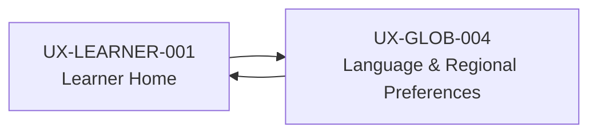

## F03 · Guest assessment booking (incl. minor gate)
*حجز تقييم مستوى لزائر (ومسار القاصر)* · requirements: FR-BOOK-002, FR-IAM-007

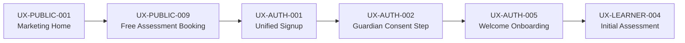

## F04 · Regional immutable payment quote
*عرض دفع إقليمي ثابت* · requirements: FR-PAY-003, FR-GEO-007

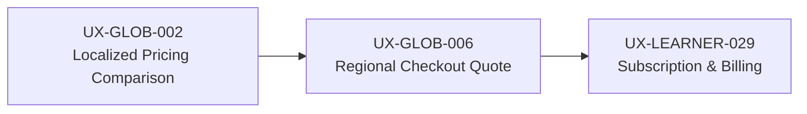

## F05 · Booking with an ambiguous DST time
*حجز حصة مع وقت ملتبس بسبب التوقيت الصيفي* · requirements: FR-TIME-004, FR-TIME-005

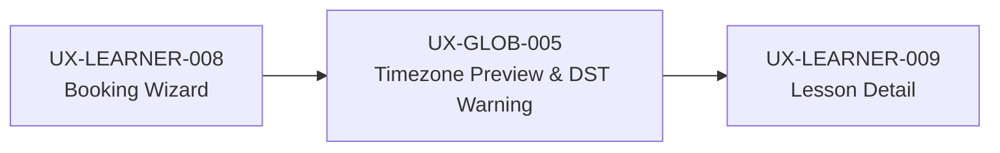

## F06 · Teacher schedule collision across markets
*تعارض جدول المعلم عبر الأسواق* · requirements: FR-TIME-006

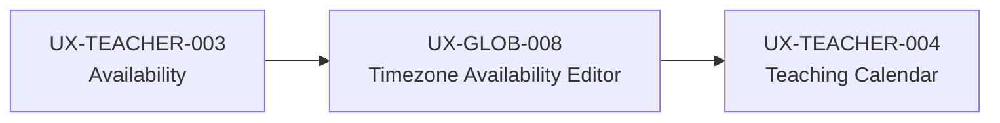

## F07 · Video provider switch with dual approval
*تبديل مزود الفيديو باعتماد مزدوج* · requirements: FR-VPC-005, FR-VPC-006

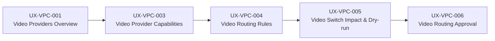

## F08 · Join via external meeting, then report
*الدخول للحصة عبر رابط خارجي ثم التقرير* · requirements: FR-VIDEO-004, FR-VPC-011

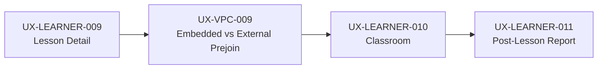

## F09 · Consent-based AI analysis with teacher approval
*تحليل ذكي بموافقة واعتماد المعلم* · requirements: FR-AI-003, FR-IAM-006

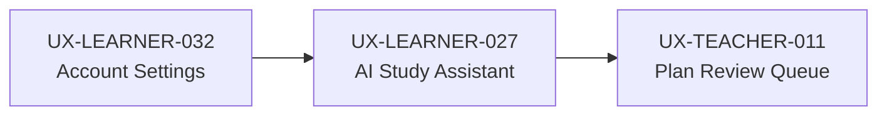

## F10 · Competition through appeal
*المسابقة حتى التظلم* · requirements: FR-CONTEST-011

```mermaid
flowchart LR
  UX_LEARNER_020["UX-LEARNER-020<br/>Competitions Discover"] --> UX_LEARNER_021["UX-LEARNER-021<br/>Competition Detail"]
  UX_LEARNER_021["UX-LEARNER-021<br/>Competition Detail"] --> UX_LEARNER_022["UX-LEARNER-022<br/>Competition Preparation"]
  UX_LEARNER_022["UX-LEARNER-022<br/>Competition Preparation"] --> UX_LEARNER_023["UX-LEARNER-023<br/>Competition Round"]
  UX_LEARNER_023["UX-LEARNER-023<br/>Competition Round"] --> UX_LEARNER_025["UX-LEARNER-025<br/>Competition Result & Appeal"]
  UX_LEARNER_025["UX-LEARNER-025<br/>Competition Result & Appeal"] --> UX_TEACHER_015["UX-TEACHER-015<br/>Appeals Academic Review"]
  UX_TEACHER_015["UX-TEACHER-015<br/>Appeals Academic Review"] --> UX_ADMIN_031["UX-ADMIN-031<br/>Contest Appeals"]
```

## F11 · Supervisor approval with scope denial
*اعتماد المشرف مع رفض النطاق* · requirements: FR-SUP-002, FR-SUP-008

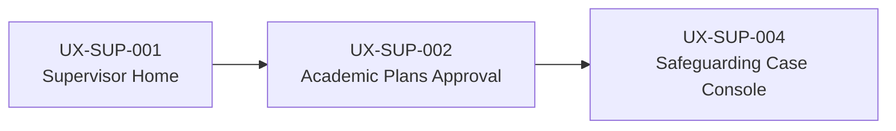

## F12 · Mobile offline draft & reconnect
*الموبايل: مسودة دون اتصال ثم العودة للحصة* · requirements: FR-MOB-002, FR-MOB-004

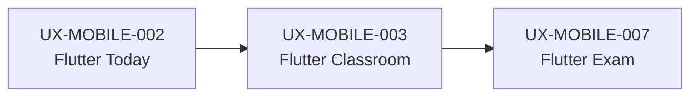

## F13 · Teacher lesson lifecycle
*دورة الحصة للمعلم* · requirements: FR-ATT-003

## F14 · Daily learning loop
*حلقة التعلم اليومية* · requirements: FR-PLAN-003, FR-PLAN-004

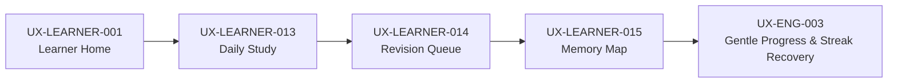

## F15 · Payroll: accrual to approval
*الرواتب: من الاستحقاق للاعتماد* · requirements: FR-PAYROLL-008, FR-SUP-006

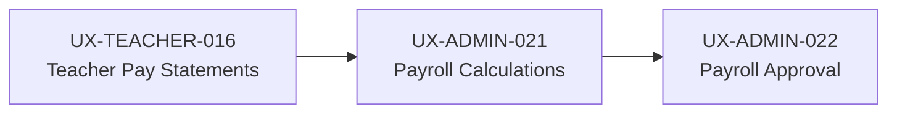

## F16 · Launch a market and price it
*إطلاق سوق جديد وتسعيره* · requirements: FR-GEO-010, FR-SUP-013

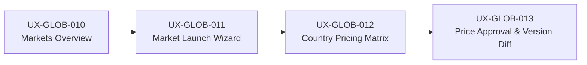

## F17 · Child safeguarding case
*حالة حماية طفل* · requirements: FR-SUP-004

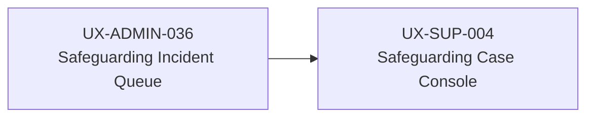

## F18 · Adaptive exam
*الاختبار التكيفي* · requirements: FR-ASMT-003

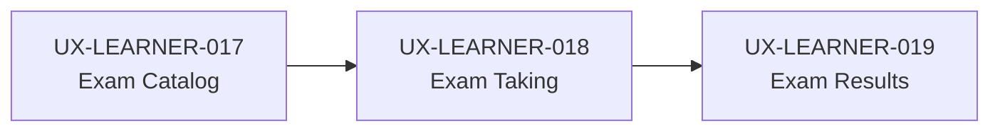

## F19 · App launch: splash to today
*تشغيل التطبيق: من الشاشة الافتتاحية إلى اليوم* · requirements: FR-MOB-001

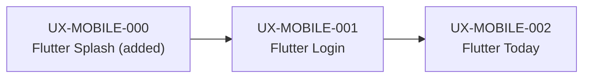
