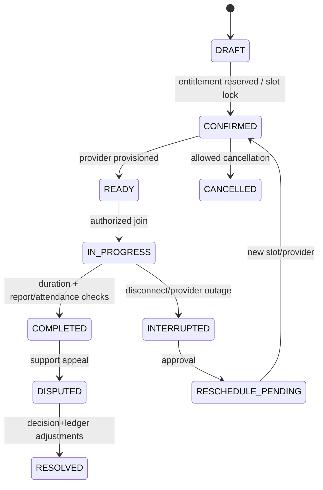
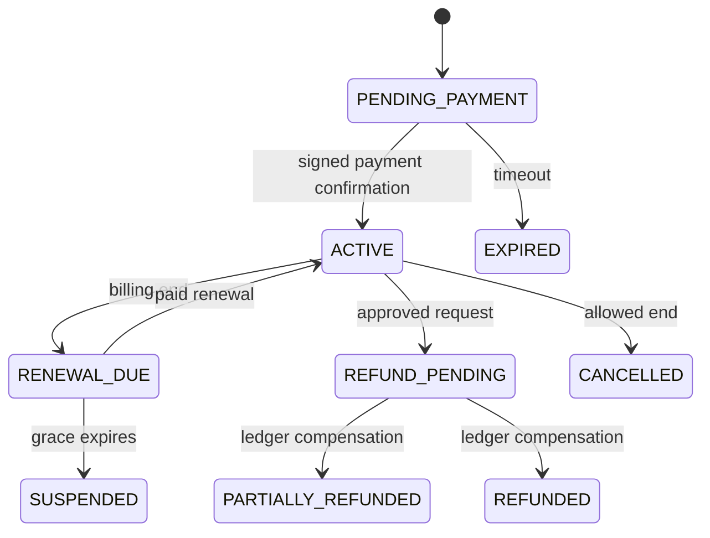
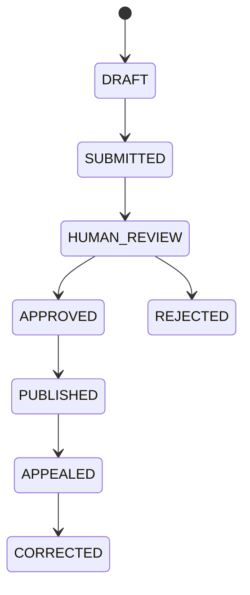

# Domain state machines & invariants

## Lesson

## Subscription

## Assessment / plan / AI suggestion

Plan version: `draft → proposed → teacher_review → approved → active → superseded/archived`; any AI-generated update starts at `proposed`. Finalized student grade never overwritten without revision history.

## Teacher compensation

`accrued → calculated → reviewed → approved → payout_requested → paid → reconciled`; `disputed` branches before/after payout with compensating adjustment. Never modify a paid payout transaction.

## Consent

`not_requested → requested → verified/granted → withdrawn/expired`; audience and purpose specific. Regrant creates new consent receipt with version/time, not overwriting previous record.

## Contest

`draft → academic_review → legal_review → scheduled → registration_open → registration_closed → running → scoring → provisional_results → appeal_window → finalized → prizes_issued → archived`. Cancel/void reason and public notice. No scored final without judge approval.

## Transaction consistency invariants

- All critical transitions check actor permission, effective state, idempotency key and ownership.
- Side effects follow transactional outbox; retries don't produce double records.
- External vendor callback cannot override an academic grade, payout or contest result.
