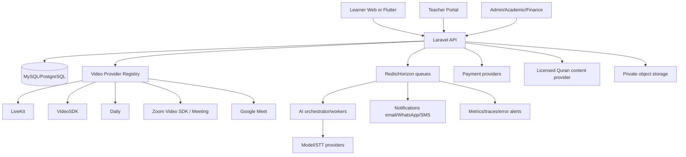

# Solution Architecture — C4, module boundaries and runtime
**ADR:** ARCH-001 | **Target:** Laravel API-first Modular Monolith + separate realtime/AI execution planes

## Architecture principles

- Business truth belongs to Laravel + transactional database; external service IDs are integrations only.
- Modular monolith in Laravel for price/booking/content/payroll complexity; queues and AI workers independently deployable when useful.
- Both Next.js and Flutter use versioned API contracts. Never embed admin-only API tokens or vendor API secrets in clients.
- Payment/teacher compensation and learning records are event-audited; no direct mutations through unversioned vendor webhooks.
- Audio processing is opt-in/purpose-scoped with kill switches, with human approval for disciplinary and academic judgments.
- Provider choice is a *capability negotiation* before booking and before join, not only interface substitution.

## C4 context (Mermaid)

## Internal Laravel modules

`Identity`, `Learners`, `GuardianConsent`, `Programs`, `AcademicContent`, `TeacherSupply`, `Schedules`, `Classroom`, `Attendance`, `Subscriptions`, `Payments`, `TeacherCompensation`, `Assessments`, `LearningPlans`, `Revision`, `Exams`, `Competitions`, `Rewards`, `Media`, `AIOrchestration`, `SessionIntelligence`, `Notifications`, `CRM`, `Finance`, `Admin`, `Support`, `Analytics`, `Compliance`.

Each module: `Domain/{Aggregate,Policy,Event,ValueObject}`, `Application/{Commands,Queries,Handlers}`, `Infrastructure/{Persistence,Clients,Jobs}`, `Http/{Controllers,Requests,Resources}`. Avoid cross-module table writes; use application service interfaces and outbox events where side effects leave transaction.

## Recommended components

| Component | Recommendation | Why | Alternative/POC |
|---|---|---|---|
| Backend | Laravel current supported release + PHP supported runtime | Fits team and API-first | Version pin in ADR |
| DB | PostgreSQL preferred for constraints/JSONB; MySQL valid option | Transactions, overlap management | Decide before migrations |
| Cache/Queues | Redis, Horizon + durable outbox | Delayed jobs and rate limits | Separate queue by criticality |
| Web | Next.js/React TypeScript | SSR public pages, DX and design system | Vue/Nuxt if team fit |
| Mobile | Flutter after core validation | Shared app across platforms | React Native if team expertise |
| Video | LiveKit / VideoSDK POC | Custom UI + audio analysis | Daily, Zoom Video SDK, Meet fallback |
| AI | Dedicated Python worker behind internal API/queue | Audio pipeline and experiments | Node workers for simpler tasks |
| Files | S3-compatible private buckets + CDN signed delivery | Security and portability | Vendor private storage |
| Analytics | Event pipeline + warehouse later | Cohorts/retention and QA | GA4 only for marketing front |
| CI/CD | GitHub Actions + deploy platform | gated tests/approvals | Equivalent pipeline |

## Source-of-truth ownership

`booking_id`, `lesson_id`, `learner_id`, `curriculum_version`, `grade`, `plan_version`, `contest_result`, `invoice`, `teacher_accrual` always platform-owned; vendor meeting IDs/recording URLs optional references only. Video replacement must not change lesson identifiers or student credit state.

## Scheduling algorithm

1. Normalize requested time to UTC, retain IANA timezone from user.
2. Validate entitled credits, teacher eligibility/level, availability and capacity.
3. Transaction acquire lock/constraint on teacher slot (range conflict for PostgreSQL or locking row strategy MySQL).
4. Create booking `confirmed`, hold entitlement credit, create provider conference lazily (just-before-lesson preferred) or reserve identifier.
5. Publish outbox event to send reminder and sync provider.
6. Resolve webhook joins with idempotency; do not complete based on client self-reported elapsed time.
7. Teacher commits academic report; credit settles to `consumed` when criteria met, else exception/support flow.

## Payment consistency pattern

Payment creation -> provider redirect/token -> signed webhook -> idempotency event store -> transition `paid` -> entitlement grant -> receipt + notification via outbox. Retries cannot create double credits. Refund is a compensating ledger transaction, not destructive deletion.

## Deployment topology

Separate environments `dev`, `staging`, `prod`; separate secrets, video projects, payment accounts, object buckets, queues and domain names. Worker queues prioritized: `payments-critical`, `classroom-events`, `notifications`, `ai-batch`, `exports`. Scale worker concurrency per queue and cap AI per user/minute. Staging must not email/pay production users.

## Observability

Correlate `request_id → payment/lesson/booking_id → provider_session_id → webhook_event_id → ai_run_id`, redact student PII. Dashboards show paid checkouts, provider join success, queue delay, audio processing errors, AI costs, unanswered safety tickets and competition scoring conflicts.

## Key ADRs to write during POC

- ADR-002: DB PostgreSQL vs MySQL with booking conflict test.
- ADR-003: Video vendor POC evidence and cost at 100/500/1000 paid learners.
- ADR-004: Consent and data residency policy signed by counsel.
- ADR-005: Quran source/riwaya and license; no raw data redistribution.
- ADR-006: Payment provider settlement and currency test EG/KSA.
- ADR-007: Teacher employment vs contractor legal forms and payroll policy.
